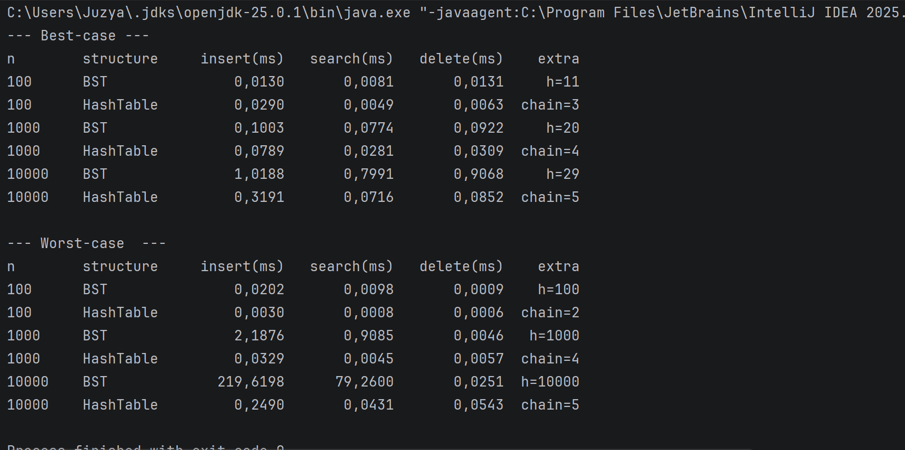

# BST vs Hash Table
## Files and how to run
The project has BST.java (Binary Search Tree), HashTable.java (Hash Table with chaining), Tests.java (correctness tests), Benchmark.java (measures the time) and results.txt (output of the benchmark).
To run it: compile with javac -d out src/main/java/org/example/*.java, then run java -cp out org.example.Tests and java -cp out org.example.Benchmark.

##  1.What is in the project
- BST.java - This is used to create the tree.
- HashTable.java - This is used to define the hash table.
- Tests.java - This is used to ensure that both data structures are giving correct output. It also does some randomized operations on the Java TreeSet data structure and compares the result with it as well.
- Benchmark.java - This is used for measuring against 100, 1000 and 10,000 keys.
- results.txt - This file contains figures obtained from the benchmark.
## 2.How I built them
**BST.** 
In BST, each node holds a unique key along with two links. 
Left refers to "less than" and right refers to "greater than", and hence we would only need to work through one side at any particular node. 
Deletion is the most complex here; a leaf is simply severed, a node having one child is then replaced with that child, while if there are two children, then it takes the maximum key available on the left side.

**Hash table.** 
It is a collection of buckets. 
The hash function would apply some operations to the key and with the help of & (size – 1), we could create an array index. 
There is a list of all keys that fall within the same bucket. 
When more than 75% of it is filled, table doubles its size and places all the keys again.
## 3.Big-O (insert, search and delete)
**BST:** 
Best:O(1)
Average: O(log n)
Worst: O(n)

**Hash table:**
Best: O(1)
Average: O(1)
Worst: O(n)

- **BST:** Cost is the number of levels. If keys are random, cost is log n. If keys are sorted, they go to the right on the tree, therefore, the tree becomes a line with n levels.
- **Hash table:** Cost is the length of a chain. With a load factor of 0.75, the chains are short. The worst case scenario is when all keys are in one bucket.
- **Resizing** costs O(n), but doubling gives 1 + 2 + 4 + …, which is smaller than 2n in total.
## 4.Results
We tested both structures with 100, 1,000 and 10,000 keys. In every test I inserted all keys, searched for all of them and then deleted all of them. I used a fixed random seed and a warm-up, and the times are in milliseconds for all n operations.

When using random keys, the hash table was more efficient as n increased. At n = 10,000, the binary search tree took 0.80 ms for the search operation while the hash table only needed 0.07 ms, giving the latter a speed advantage of almost 11 times. The performance for delete was similar, while the time taken during insertion was about 3 times less. Already at n = 1,000, the hash table was approximately 3 times quicker than the BST for search and delete, whereas the times were nearly identical for insertion. At n = 100, the figures obtained were very small as were the differences between the two data structures; the binary search tree outperformed the hash table in terms of insertion operation due to the resizing of the hash table, but the latter still won in search and delete. When n was multiplied by 10, the run time of the binary search tree showed a parallel pattern while the hash table showed less increase in run time.

When the keys are in sorted order the BST becomes extremely inefficient. The time taken to insert when n = 10,000 is 219.6 ms and searching takes 79.3 ms. This occurs here because the height of the tree was 10,000 in that case making it a degenerate tree. The hash table on the other hand required only 0.25 ms and 0.04 ms. The time taken to delete in BST seems to be very low (0.03 ms) here. This is due to the fact that I deleted in sorted order, thus always eliminating the root. It is worth noting that this is a special case in my experiment and it is not representative of the general situation.
## 5.Why they behave so differently
1. The hash table calculates one index and examines a short chain, whereas the BST has to traverse the number of nodes equal to the number of levels of the tree.
2. The value of the BST is dependent on the order of the input data, while the hash table is not. The AVL and Red-Black trees overcome this problem.
3. In the case of the tree data structure, the nodes are scattered in the memory and linked by means of pointers, while the bucket array is in one piece, thus being more CPU cache-friendly.
4. One big advantage of the BST is that it is able to sort keys, that is why it has the potential of returning the minimum, maximum, and the sorted list of the keys.
## 6.Conclusion 
The hash table was superior to the BST for simple insert, search and delete in my tests. The BST was fast only for random keys; when it came to sorted keys the performance deteriorated into linear time, and insertion at n = 10,000 was roughly 880 times slower than in the hash table. However, the BST is still valuable when the ordering of the keys is important, especially in a balanced tree (AVL or Red-Black).